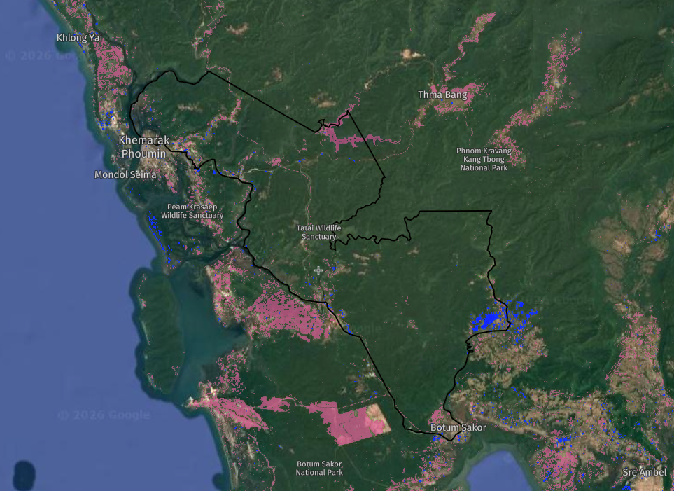

# Tatai Wildlife Sanctuary

  

  <strong>Landsat NDVI change detection · Cardamom Mountains, Cambodia · 2013–2025</strong>

  Alex Bertault · Remote Sensing · Conservation GIS

  
  
  
  

---

How has protected-area designation shaped vegetation health in Tatai Wildlife Sanctuary since 2016?

**Short answer:** vegetation stayed largely stable. Mean NDVI moved from **0.403 → 0.397** (Δ −0.006). The losses that matter are local: the Stung Tatai hydropower reservoir, fire-affected patches, and newer road corridors.

| | |
|---|---|
| **Location** | Koh Kong Province, Cambodia · 144,539 ha |
| **Imagery** | Landsat 8/9 · December dry season |
| **Epochs** | 2013 · 2020 · 2025 |
| **Stack** | ArcGIS Pro · Python · rasterio · GeoPandas · NASA FIRMS · OSM · Global Forest Watch |

---

## NDVI through time

| 2013 | 2020 | 2025 |
|:---:|:---:|:---:|
|  |  |  |

Dry-season scenes keep cloud cover and seasonal greenness more comparable across years.

### Where change actually happened

Red = loss · green = gain. Decline concentrates at the dam footprint and fire clusters, not sanctuary-wide dieback.

### Trend

### Forest cover context

Global Forest Watch: fire-driven forest loss rose after designation (150 ha in 2016–24 vs 41 ha in 2005–15), while total tree-cover loss across both periods was about 3.2 kha.

---

## Approach

1. Compute NDVI from Landsat 8/9 multispectral bands for December 2013, 2020, and 2025
2. Difference the 2013 and 2025 rasters for spatial change detection
3. Overlay NASA FIRMS fire alerts (285 alerts, 2015–2025) and Global Forest Watch loss stats
4. Compare Geofabrik OSM road networks (2020 vs 2025) against NDVI loss zones

Processed outputs live in [`data/processed/`](data/processed/) (zonal stats + study boundary). Scripts to rebuild them are in [`scripts/`](scripts/).

---

## Site context

Established May 2016 (Sub-Decree No. 80) in the Cardamom Rainforest. Part of the Southern Cardamom REDD+ landscape. 650+ documented species.

| Zone | Area | Share |
|------|------|-------|
| Core | 42,872 ha | ~30% |
| Conservation | 54,045 ha | ~37% |
| Sustainable use | 18,558 ha | ~13% |
| Community | 29,064 ha | ~20% |

---

## Takeaways

- Sanctuary-wide greenness held steady after designation; the signal is stability, not collapse
- The clearest NDVI drop tracks the Stung Tatai reservoir (forest converted to open water)
- Fire alerts and road expansion help explain the other localized loss pockets
- Outside those footprints, most of the sanctuary shows stable or slightly improving NDVI

---

## Data sources

- [Protected Planet / WDPA](https://www.protectedplanet.net) · sanctuary boundary
- USGS Landsat 8/9 Collection 2
- [NASA FIRMS](https://firms.modaps.eosdis.nasa.gov/) · fire alerts
- [Global Forest Watch](https://www.globalforestwatch.org/) · tree-cover loss
- [Geofabrik](https://download.geofabrik.de/) · OpenStreetMap roads
