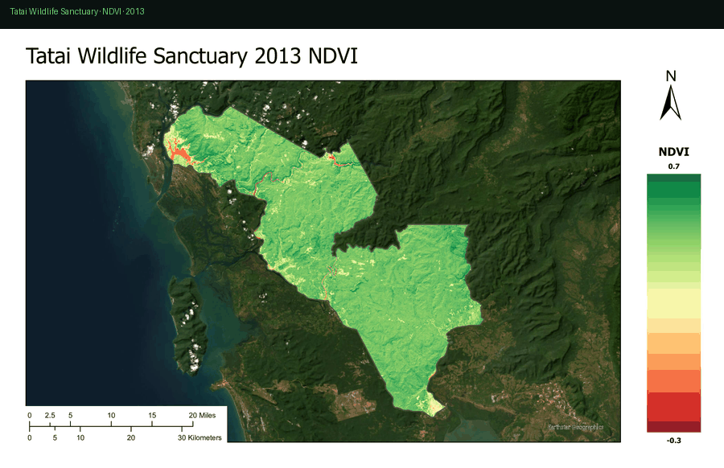
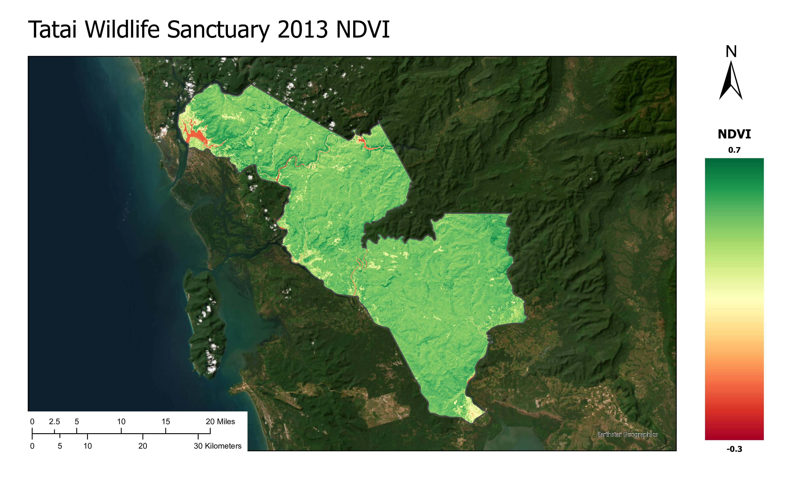
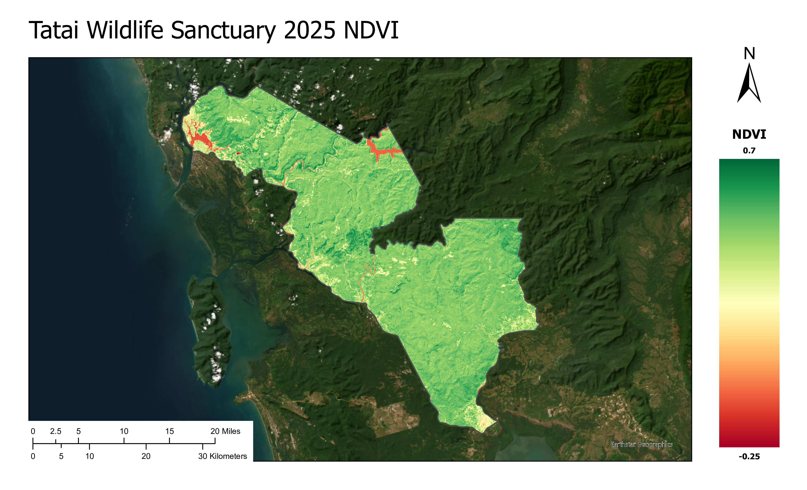
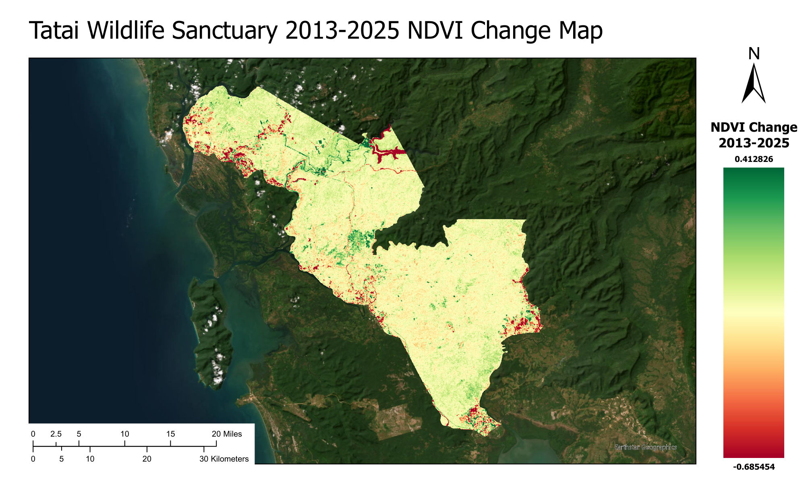
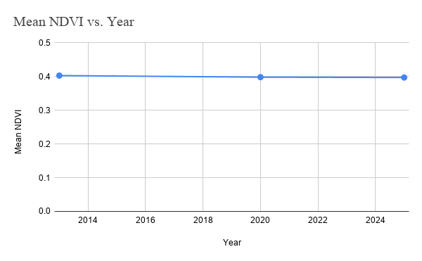

# Tatai Wildlife Sanctuary · Remote Sensing

<p align="center">
  
</p>

<p align="center">
  <strong>12-year Landsat NDVI assessment</strong> · Cambodia Cardamom Mountains · 144,539 ha protected area
</p>

Multi-temporal analysis shows vegetation remained **largely stable** (−0.006 mean NDVI, 2013→2025) with localized loss at the hydropower reservoir and fire zones.

**Alex Bertault** · Remote Sensing · Conservation GIS

<p align="center">
  
  
  
  
</p>

---

## At a glance

| | |
|---|---|
| **Location** | Koh Kong Province, Cambodia |
| **Imagery** | Landsat 8/9 C2 L1 · December dry season |
| **Epochs** | 2013 · 2020 · 2025 |
| **Mean NDVI** | 0.403 → 0.397 |
| **Stack** | Python · rasterio · GeoPandas · ArcGIS Pro · NASA FIRMS · OSM |

---

## Key maps

### NDVI time series

| 2013 (baseline) | 2020 | 2025 |
|:---:|:---:|:---:|
|  |  |  |

### Change detection · 2013–2025



Red = vegetation loss · Green = gain · Localized stress at dam footprint and fire clusters, not sanctuary-wide decline.

### Mean NDVI trend



---

## Research question

> How has the establishment of Tatai Wildlife Sanctuary influenced vegetation health and landscape change since 2016?

**Finding:** Designation did not produce broad vegetation decline. NDVI stability suggests ecological resilience; observed losses tie to **Stung Tatai hydropower** (forest→water), **FIRMS fire alerts** (285 alerts, 2015–2025), and **OSM road expansion** (2020→2025).

---

## Methods

1. **NDVI** from Landsat 8/9 multispectral bands (dry-season Dec scenes)
2. **Change detection** — pixel-wise NDVI difference 2013–2025
3. **Fire context** — NASA FIRMS MODIS + Global Forest Watch (150 ha fire loss 2016–24 vs 41 ha 2005–15)
4. **Infrastructure** — Geofabrik OSM road layers compared across epochs

---

## Repo layout

```
assets/              Map exports (PNG/JPG) — renders in this README
data/processed/      Web-friendly derivatives (GeoJSON, JSON stats)
docs/                Optional static HTML (GitHub Pages, no backend)
scripts/             Reproducible Python pipeline
data/raw/            Full rasters (~5.5 GB, gitignored — local only)
```

### Processed data (small, commit-safe)

- [`data/processed/ndvi_stats.json`](data/processed/ndvi_stats.json) — zonal NDVI summary
- [`data/processed/tatai_boundary.geojson`](data/processed/tatai_boundary.geojson) — study boundary

### Re-run stats locally

```bash
python3 -m venv .venv && source .venv/bin/activate
pip install -r requirements.txt
python scripts/compute_ndvi_stats.py
python scripts/export_boundary.py
```

Requires `data/raw/` extracted locally. No server needed to view this README.

---

## Interactive demo (optional)

Before/after NDVI swipe map in [`docs/swipe.html`](docs/swipe.html) — enable GitHub Pages on `/docs` for a hosted link, no backend.

---

## Protection context

| Zone | Area | Share |
|------|------|-------|
| Core | 42,872 ha | ~30% |
| Conservation | 54,045 ha | ~37% |
| Sustainable use | 18,558 ha | ~13% |
| Community | 29,064 ha | ~20% |

Established May 2016 (Sub-Decree No. 80) · 650+ documented species · Southern Cardamom REDD+ participant

---

## References

- UNEP-WCMC / IUCN [Protected Planet](https://www.protectedplanet.net) (WDPA boundary)
- USGS Landsat 8/9 Collection 2
- [NASA FIRMS](https://firms.modaps.eosdis.nasa.gov/) fire alerts
- [Global Forest Watch](https://www.globalforestwatch.org/) tree-cover loss
- [Geofabrik](https://download.geofabrik.de/) OpenStreetMap extracts
